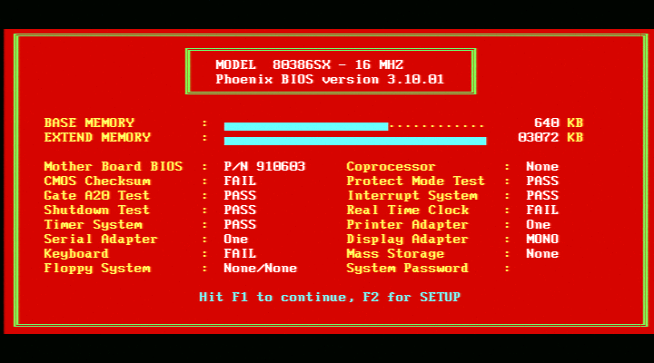

# EpiphanVGA2USB

A native Linux userspace driver for the original Epiphan VGA2USB (`5555:1110`) capture device.

I wanted to capture BIOS screens and video output from old PCs without keeping a fairly old Linux installation around to accompany them. Epiphan's original Linux driver depends on kernel interfaces that have long since disappeared, so this is a replacement built around libusb.

The USB protocol and firmware loading sequence were recovered from Epiphan's old driver. The proprietary kernel module itself isn't used.

**This is for the original VGA2USB, not the VGA2USB LR.** Their firmware and setup commands aren't interchangeable.

## Status



The screenshot is a native capture of the Phoenix BIOS on a 16 MHz 80386SX.

Currently working:

- Extracting and checking the original firmware, then loading it into the device's RAM
- Detecting VGA timing and capturing RGB565 frames
- Saving PPM screenshots and displaying live video through ffplay
- Recovering from incomplete frame transfers
- Clearing the live display when the VGA signal disappears and resuming when it returns

720×400 text mode has been tested on actual hardware, including recovery after a cold power cycle of the source PC without restarting the capture software.

Other progressive VGA timings are implemented, but still need physical testing. Interlaced modes aren't supported, and USB unplug/reconnect recovery is manual for now.

The test host captured about 8.8 complete frames per second at five capture phases.

## Building

You'll need a C compiler, Ninja, pkg-config, libusb-1.0 development files, Ruby (with minitest and zlib), binutils, and FFmpeg for the viewer and its tests.

The firmware isn't included in this repository. Download the identified Epiphan driver package and extract the firmware object as described in [firmware/README.md](firmware/README.md). No kernel module needs to be built or loaded.

Then run:

```sh
ninja test driver firmware-audit
```

This builds `build/vga2usb-native` and runs the offline checks.

## Using it

Inspect the device:

```sh
./build/vga2usb-native --inspect
```

Load its volatile RAM firmware if needed:

```sh
sudo ./build/vga2usb-native --bootstrap
```

After the device re-enumerates, inspect it again. Capture a screenshot with:

```sh
sudo ./build/vga2usb-native --capture screen.ppm
```

Or open the live viewer:

```sh
sudo -v
./tools/view-live.sh
```

The viewer opens full-screen through ffplay. It uses `sudo -n` for USB access, so you need cached sudo credentials or suitable permissions.

If you have multiple devices, `--port 1-12.2` (using the physical path reported by `--inspect`) selects one. Only one process can claim a device's capture interface at a time.

See the [usage guide](docs/usage.md) for modes, recovery, permissions, streaming, and troubleshooting.

## Documentation

- [Documentation index](docs/README.md)
- [USB protocol and capture implementation](docs/protocol/README.md)
- [Hardware test results](docs/hardware/README.md)
- [Vendor driver versus a modern Linux kernel](docs/kernel-abi.md)
- [Firmware extraction and provenance](firmware/README.md)

The protocol notes distinguish what was recovered from disassembly from what was actually tested on hardware. Some fields are still unknown.

## License

The source code is licensed under the University of Illinois/NCSA Open Source License; see [LICENSE](LICENSE).

Epiphan's firmware and original driver remain proprietary and aren't covered by that license. This project is independent of Epiphan and isn't an official driver.
